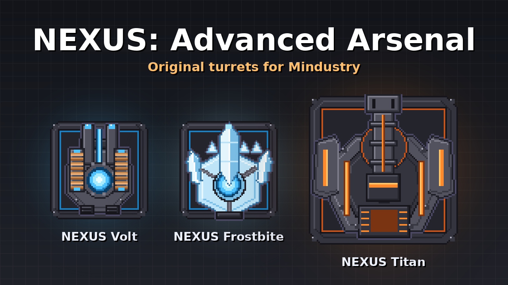

# NEXUS: Advanced Arsenal

[English](README.md) · [Українська](README.uk.md) · [Русский](README.ru.md)



A [Mindustry](https://github.com/Anuken/Mindustry) mod that adds original turrets with their own mechanics, effects and original pixel art. Each turret has a distinct role instead of being a stronger copy of a vanilla one.

**Target game version:** Mindustry v8, build 160.4 (`minGameVersion: 160`). The mod is pure JSON (no Java or JavaScript).

## Turrets

| Turret | Size | Role | Range | Fire rate | Cost |
|---|---|---|---|---|---|
| **Volt** | 2×2 | Chain lightning: each orb bursts into 3 arcs that hit nearby enemies. Ground and air. | 18 tiles | 2 shots/s | 80 copper, 100 lead, 60 silicon, 20 metaglass |
| **Frostbite** | 2×2 | Ice shards that slow and freeze. **Extinguishes fires.** Water, or cryofluid for a bigger icy burst with shrapnel. | 20 tiles | 2.5 shots/s | 90 copper, 60 graphite, 40 silicon, 30 titanium |
| **Titan** | 3×3 | Heavy armor-piercing cannon with strong recoil. Graphite, or thorium that ignores armor and pierces up to 3 targets. Ground only. | 26 tiles | ~0.6 shots/s | 200 copper, 180 graphite, 120 titanium, 80 silicon |

Volt needs power (4 units/tick). Volt and Titan accept optional coolant. In the campaign, research Volt after *Arc*, Frostbite after *Wave*, and Titan after *Ripple*.

Frostbite prioritizes fires over enemies while a fire is in range, like the vanilla Wave. One turret cannot beat a large blaze; use several.

## Installation

Pick one:

1. **Mod Browser** — Mods → *Mod Browser*, search for "NEXUS: Advanced Arsenal" and press *Install*.
2. **From GitHub** — Mods → *Import Mod* → *Import From GitHub* → enter `Bluer255/NEXUS-Advanced-Arsenal`.
3. **Manually** — download `NEXUS-Advanced-Arsenal-vX.Y.Z.zip` from [Releases](../../releases), then Mods → *Import Mod* → *Import File* (or drop the zip into the game's `mods` folder). Do not unzip it.

## Languages

English, Ukrainian (`uk_UA`) and Russian (`ru`). Turret names follow the game's language: for example *NEXUS Titan* / *NEXUS Титан*, *NEXUS Volt* / *NEXUS Шок*, *NEXUS Frostbite* / *NEXUS Заморозка*.

## Compatibility and testing

- Every push is checked by CI: textures, sizes and localization keys are validated, then the mod is loaded in a headless Mindustry v160.4 server and a regression test checks that Frostbite puts out a fire.
- CI cannot check how things look or sound in the graphical client or how the balance feels. Please [open an issue](../../issues) if something looks or plays wrong.
- Being JSON-only, the mod should work on every platform; it is mainly played on PC.

## Building from source

Sprites, localization files and the preview are generated by scripts in `tools/` (Python 3 + Pillow):

```bash
pip install -r tools/requirements.txt
python tools/gen_sprites.py    # sprites/blocks/turrets/*.png
python tools/gen_bundles.py    # bundles/*.properties (en, uk_UA, ru)
python tools/gen_preview.py    # preview.png, icon.png
python tools/validate.py       # hjson <-> textures <-> localization
bash tools/ci_load_test.sh     # headless server test (needs Java 17+, curl, zip)
```

The installable mod is the repository root: `mod.hjson`, `content/`, `sprites/`, `bundles/`, `icon.png`, `preview.png`.

## Releasing

1. Raise `version` in `mod.hjson` (semver; the game uses it to detect updates).
2. Add the changes to `CHANGELOG.md`.
3. `git tag vX.Y.Z && git push origin vX.Y.Z` — the *Release* workflow checks that the tag matches `version`, runs the tests and publishes a release named `... [v160]`.

For the Mod Browser, the repository needs the topic `mindustry-mod`; the list refreshes automatically every few hours.

## Roadmap

Planned: Pyrox (plasma), Phantom (laser), Reaper (homing missiles), Swarm (drones), Devastator (artillery), Singularity (gravity) and Omega (endgame beam).

## Contributing

Issues and pull requests are welcome. Before submitting, run `python tools/validate.py` and `bash tools/ci_load_test.sh`. Do not edit PNG files directly if they are produced by `tools/gen_sprites.py`; change the script (or replace the sprite deliberately and note it in the PR).

## License

[MIT](LICENSE). All sprites are original and generated by the scripts in this repository; no vanilla Mindustry assets are included. This is an unofficial fan mod; Mindustry is created by Anuken.
