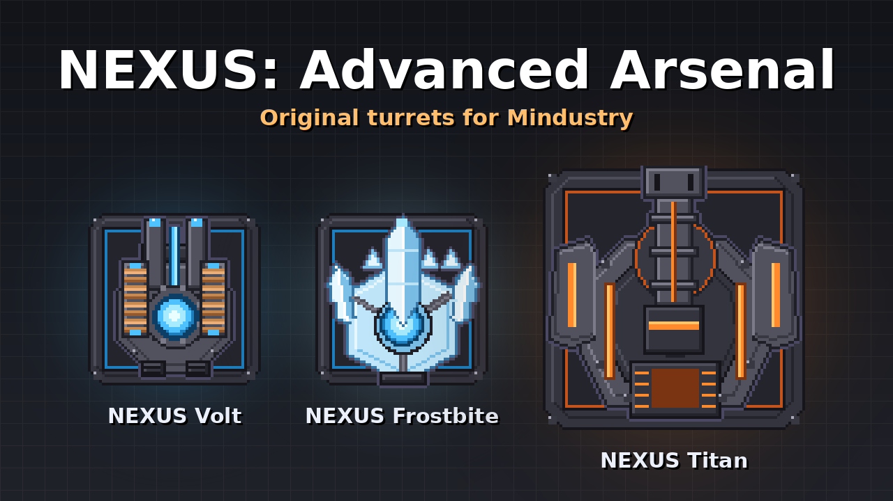

# NEXUS: Advanced Arsenal

[English](README.md) · [Українська](README.uk.md) · [Русский](README.ru.md)



Мод для [Mindustry](https://github.com/Anuken/Mindustry), добавляющий оригинальные турели со своими механиками, эффектами и пиксель-артом. У каждой турели своя роль, а не просто усиленная копия ванильной.

**Целевая версия игры:** Mindustry v8, сборка 160.4 (`minGameVersion: 160`). Мод полностью на JSON (без Java и JavaScript).

## Турели

| Турель | Размер | Роль | Дальность | Скорость | Стоимость |
|---|---|---|---|---|---|
| **NEXUS Шок** (Volt) | 2×2 | Цепная молния: каждый шар распадается на 3 дуги по соседним врагам. Наземные и воздушные цели. | 18 клеток | 2 выстрела/с | 80 меди, 100 свинца, 60 кремния, 20 метастекла |
| **NEXUS Заморозка** (Frostbite) | 2×2 | Ледяные осколки, замедляющие и замораживающие. **Тушит пожары.** Вода или криожидкость для более мощного ледяного взрыва с осколками. | 20 клеток | 2,5 выстрела/с | 90 меди, 60 графита, 40 кремния, 30 титана |
| **NEXUS Титан** (Titan) | 3×3 | Тяжёлая бронебойная пушка с сильной отдачей. Графит или торий, игнорирующий броню и пробивающий до 3 целей. Только наземные цели. | 26 клеток | ~0,6 выстрела/с | 200 меди, 180 графита, 120 титана, 80 кремния |

Шоку нужна энергия (4 ед./тик). Шок и Титан принимают необязательное охлаждение. В кампании исследуйте Шок после *Arc*, Заморозку после *Wave*, Титан после *Ripple*.

Заморозка в первую очередь целится в пожары, а не во врагов, пока пожар в зоне досягаемости (как ванильная Wave). Одна турель не справится с большим пожаром: ставьте несколько.

## Установка

Выберите один способ:

1. **Браузер модов** — Mods → *Mod Browser*, найдите «NEXUS: Advanced Arsenal» и нажмите *Install*.
2. **С GitHub** — Mods → *Import Mod* → *Import From GitHub* → введите `Bluer255/NEXUS-Advanced-Arsenal`.
3. **Вручную** — скачайте `NEXUS-Advanced-Arsenal-vX.Y.Z.zip` со страницы [Releases](../../releases), затем Mods → *Import Mod* → *Import File* (или положите zip в папку `mods` игры). Архив не распаковывайте.

## Языки

Английский, украинский (`uk_UA`) и русский (`ru`). Названия турелей зависят от языка игры: *NEXUS Титан*, *NEXUS Шок*, *NEXUS Заморозка*.

## Совместимость и тестирование

- Каждый push проверяет CI: валидация текстур, размеров и ключей локализации, затем мод загружается в headless-сервере Mindustry v160.4, а регрессионный тест проверяет, что Заморозка тушит пожар.
- CI не может проверить внешний вид и звук в графическом клиенте и ощущения от баланса. Если что-то выглядит или играет не так, [создайте issue](../../issues).
- Мод полностью на JSON, поэтому должен работать на всех платформах; основная платформа — ПК.

## Сборка из исходников

Спрайты, локализации и превью генерируют скрипты в `tools/` (Python 3 + Pillow):

```bash
pip install -r tools/requirements.txt
python tools/gen_sprites.py    # sprites/blocks/turrets/*.png
python tools/gen_bundles.py    # bundles/*.properties (en, uk_UA, ru)
python tools/gen_preview.py    # preview.png, icon.png
python tools/validate.py       # hjson <-> текстуры <-> локализация
bash tools/ci_load_test.sh     # тест в headless-сервере (Java 17+, curl, zip)
```

Устанавливаемый мод — это корень репозитория: `mod.hjson`, `content/`, `sprites/`, `bundles/`, `icon.png`, `preview.png`.

## Выпуск версии

1. Увеличьте `version` в `mod.hjson` (semver; по ней игра ищет обновления).
2. Добавьте изменения в `CHANGELOG.md`.
3. `git tag vX.Y.Z && git push origin vX.Y.Z` — workflow *Release* проверит совпадение тега с `version`, запустит тесты и опубликует релиз с названием `... [v160]`.

Чтобы мод появился в браузере модов, у репозитория должна быть тема `mindustry-mod`; список обновляется автоматически раз в несколько часов.

## Планы

Запланированы: Pyrox (плазма), Phantom (лазер), Reaper (самонаводящиеся ракеты), Swarm (дроны), Devastator (артиллерия), Singularity (гравитация) и Omega (конечный луч).

## Вклад

Issues и pull request приветствуются. Перед отправкой запустите `python tools/validate.py` и `bash tools/ci_load_test.sh`. PNG-файлы, создаваемые `tools/gen_sprites.py`, не правьте напрямую: измените скрипт (или замените спрайт осознанно и укажите это в PR).

## Лицензия

[MIT](LICENSE). Все спрайты оригинальные и созданы скриптами этого репозитория; ресурсов ванильной Mindustry здесь нет. Это неофициальный фан-мод; Mindustry создан Anuken.
