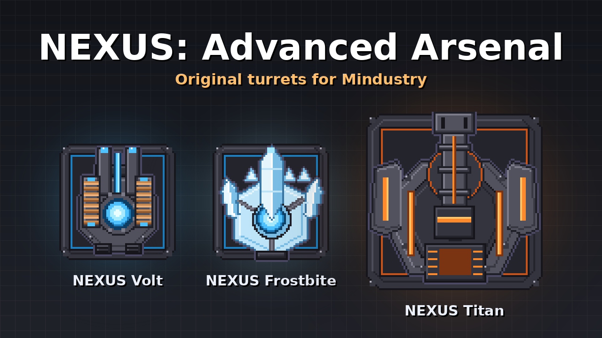

# NEXUS: Advanced Arsenal

[English](README.md) · [Українська](README.uk.md) · [Русский](README.ru.md)



Мод для [Mindustry](https://github.com/Anuken/Mindustry), що додає оригінальні турелі з власними механіками, ефектами та піксель-артом. Кожна турель має свою роль, а не є сильнішою копією ванільної.

**Цільова версія гри:** Mindustry v8, збірка 160.4 (`minGameVersion: 160`). Мод повністю на JSON (без Java та JavaScript).

## Турелі

| Турель | Розмір | Роль | Дальність | Швидкість | Вартість |
|---|---|---|---|---|---|
| **NEXUS Шок** (Volt) | 2×2 | Ланцюгова блискавка: кожен орб розпадається на 3 дуги по сусідніх ворогах. Наземні й повітряні цілі. | 18 клітинок | 2 постріли/с | 80 міді, 100 свинцю, 60 кремнію, 20 металоскла |
| **NEXUS Заморозка** (Frostbite) | 2×2 | Крижані осколки, що сповільнюють і заморожують. **Гасить пожежі.** Вода, або кріорідина для більшого крижаного вибуху з уламками. | 20 клітинок | 2,5 пострілу/с | 90 міді, 60 графіту, 40 кремнію, 30 титану |
| **NEXUS Титан** (Titan) | 3×3 | Важка бронебійна гармата з потужною віддачею. Графіт, або торій, що ігнорує броню й пробиває до 3 цілей. Лише наземні цілі. | 26 клітинок | ~0,6 пострілу/с | 200 міді, 180 графіту, 120 титану, 80 кремнію |

Шок потребує енергії (4 од./тік). Шок і Титан приймають опційне охолодження. У кампанії досліджуйте Шок після *Arc*, Заморозку після *Wave*, Титан після *Ripple*.

Заморозка пріоритетно цілиться у пожежі, а не у ворогів, поки пожежа в радіусі дії (як ванільна Wave). Одна турель не здолає велику пожежу: ставте кілька.

## Встановлення

Оберіть один спосіб:

1. **Браузер модів** — Mods → *Mod Browser*, знайдіть «NEXUS: Advanced Arsenal» і натисніть *Install*.
2. **З GitHub** — Mods → *Import Mod* → *Import From GitHub* → введіть `Bluer255/NEXUS-Advanced-Arsenal`.
3. **Вручну** — завантажте `NEXUS-Advanced-Arsenal-vX.Y.Z.zip` зі сторінки [Releases](../../releases), потім Mods → *Import Mod* → *Import File* (або покладіть zip у папку `mods` гри). Архів не розпаковуйте.

## Мови

Англійська, українська (`uk_UA`) і російська (`ru`). Назви турелей залежать від мови гри: *NEXUS Титан*, *NEXUS Шок*, *NEXUS Заморозка*.

## Сумісність і тестування

- Кожен push перевіряє CI: валідація текстур, розмірів і ключів локалізації, потім мод вантажиться у headless-сервері Mindustry v160.4, а регресійний тест перевіряє, що Заморозка гасить пожежу.
- CI не може перевірити вигляд і звук у графічному клієнті та відчуття від балансу. Якщо щось виглядає чи грає не так, [створіть issue](../../issues).
- Мод повністю на JSON, тож має працювати на всіх платформах; основна платформа — ПК.

## Збірка з вихідників

Спрайти, локалізації та превʼю генерують скрипти в `tools/` (Python 3 + Pillow):

```bash
pip install -r tools/requirements.txt
python tools/gen_sprites.py    # sprites/blocks/turrets/*.png
python tools/gen_bundles.py    # bundles/*.properties (en, uk_UA, ru)
python tools/gen_preview.py    # preview.png, icon.png
python tools/validate.py       # hjson <-> текстури <-> локалізація
bash tools/ci_load_test.sh     # тест у headless-сервері (Java 17+, curl, zip)
```

Мод для встановлення — це корінь репозиторію: `mod.hjson`, `content/`, `sprites/`, `bundles/`, `icon.png`, `preview.png`.

## Випуск версії

1. Збільште `version` у `mod.hjson` (semver; за нею гра шукає оновлення).
2. Додайте зміни до `CHANGELOG.md`.
3. `git tag vX.Y.Z && git push origin vX.Y.Z` — workflow *Release* перевірить збіг тегу з `version`, запустить тести й опублікує реліз з назвою `... [v160]`.

Щоб мод зʼявився в браузері модів, репозиторій має мати тему `mindustry-mod`; список оновлюється автоматично раз на кілька годин.

## Плани

Заплановані: Pyrox (плазма), Phantom (лазер), Reaper (самонавідні ракети), Swarm (дрони), Devastator (артилерія), Singularity (гравітація) і Omega (кінцевий промінь).

## Внесок

Issues і pull request вітаються. Перед надсиланням запустіть `python tools/validate.py` та `bash tools/ci_load_test.sh`. PNG-файли, які створює `tools/gen_sprites.py`, не правте напряму: змініть скрипт (або замініть спрайт свідомо й вкажіть це в PR).

## Ліцензія

[MIT](LICENSE). Усі спрайти оригінальні й створені скриптами цього репозиторію; ресурсів ванільної Mindustry тут немає. Це неофіційний фан-мод; Mindustry створив Anuken.
